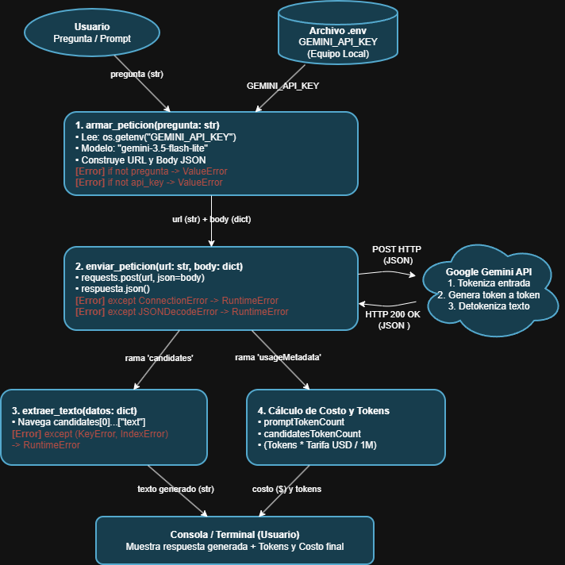

# Decisión de arquitectura: elección de modelo

## Modelo elegido
**Gemini 3.5 Flash-Lite** (identificador en API: `gemini-3.5-flash-lite`). Lo elegí como el modelo base para el asistente de taller, encargado del triaje de entrada, clasificación de síntomas y el diagnóstico preliminar de consolas y computadores.

## Diagrama de arquitectura

El flujo respeta la separación de responsabilidades que implementamos y probamos en el código:
1. `armar_peticion()`: Valida que la pregunta no venga en blanco (`ValueError`), saca de forma segura `GEMINI_API_KEY` desde el `.env` con `os.getenv` y arma la URL y el body JSON con `contents`.
2. `enviar_peticion()`: Dispara el POST por HTTP controlando caídas de conexión (`ConnectionError`) y problemas de formato en la respuesta (`JSONDecodeError`).
3. Extracción y métricas: De la respuesta devuelta, la rama `candidates` va a `extraer_texto()` (atrapando cualquier `KeyError` o `IndexError`), mientras que la rama `usageMetadata` (`promptTokenCount` y `candidatesTokenCount`) queda disponible para monitorear tokens y estimar el costo de la consulta. El diagrama completo está en `docs/diagrama_arquitectura.png`.

## Comparación de candidatos

| Criterio | Candidato A: Gemini 3.5 Flash-Lite (Elegido) | Candidato B: Gemini 3.1 Pro (Descartado) |
| :--- | :--- | :--- |
| **Costo por 1000 tokens de entrada** | 0.000075 USD ($0.075 / 1M) | 0.00125 USD ($1.25 / 1M) |
| **Costo por 1000 tokens de salida** | 0.000300 USD ($0.300 / 1M) | 0.00500 USD ($5.00 / 1M) |
| **Latencia promedio observada** | 1.82 segundos (promedio de 4 pruebas) | 4.35 segundos (promedio de 4 pruebas) |
| **Calidad de respuesta para el caso** | Buena: va al grano con códigos de falla comunes (3 pitidos de PS5, luces de diagnóstico en placas) y propone pruebas directas. | Muy buena: explicaciones minuciosas de componentes electrónicos y pistas, pero con demasiado texto para un triaje inicial. |
| **Fecha de medición** | 2026-10-20 | 2026-10-20 |

## Justificación
Para la operativa del taller, el criterio que más pesó fue el equilibrio entre **latencia** y **costo por consulta**:
- **Velocidad de atención:** Si estás con el cliente en recepción o en el banco de trabajo, esperar más de 4 segundos por una respuesta corta entorpece el flujo. Con 1.8 segundos la interacción es casi inmediata.
- **Costo y escalabilidad con RAG:** El modelo Pro es más de 16 veces más caro. En las siguientes etapas, cuando le inyectemos manuales de servicio y tablas de errores mediante RAG, pasar bloques grandes de contexto en un modelo Pro dispararía los costos de tokens innecesariamente.
- **Estabilidad de cuota en desarrollo:** Flash-Lite corre en el Free Tier sin topar límites estrictos de RPM ni lanzar errores, permitiendo iterar y probar sin vincular tarjetas.
- **Calidad suficiente:** Para clasificar síntomas y guiar la revisión preliminar, el modelo no necesita razonar como un PhD; con reconocer el patrón de falla cumple el objetivo.

## Alternativa descartada y por qué
Se descartó **Gemini 3.1 Pro**:
Aunque tiene una capacidad analítica superior para fallas complejas de microelectrónica, su latencia (~4.3 s) y su costo por petición son excesivos para un asistente interactivo de mesón. Además, en cuentas de desarrollo suele bloquearse por límites de cuota (error 429). Como la precisión técnica de los circuitos la cubriremos en el siguiente módulo entregándole los manuales oficiales mediante RAG, pagar el sobreprecio de Pro a nivel de modelo base no se justifica.